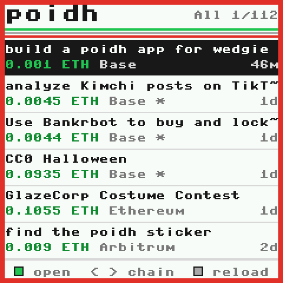
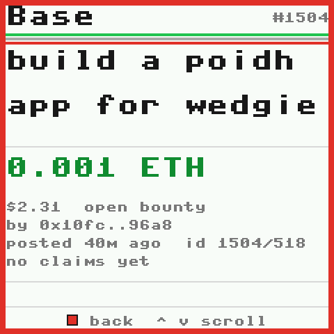
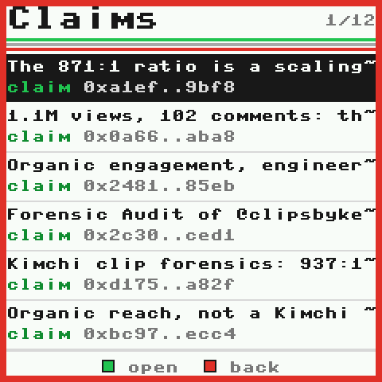

# poidh for wedgie

Browse live [poidh](https://poidh.xyz) bounties on a [wedgie](https://wedgie.dev). It shows open bounties on Ethereum, Base and Arbitrum: titles, ETH rewards, descriptions and details, and every claim on a bounty. You move through them with the joystick and buttons, and it is laid out for the 240x240 screen.

A wedgie has no internet, so a small bridge script on your computer fetches the data from poidh and passes it to the wedgie over USB. All data is real and live: the bridge reads poidh's own public feeds. Nothing is hard-coded.

**Demo video (virtual wedgie):** [media/poidh-wedgie-demo.mp4](https://github.com/swiftbotlab/wedgie-poidh/raw/main/media/poidh-wedgie-demo.mp4)

| Bounties | A bounty | Its claims | One claim |
|---|---|---|---|
|  |  |  |  |

## Controls

| On the wedgie | What it does |
|---|---|
| Joystick up / down | move through the list, or scroll text |
| Joystick left / right | switch chain: All, Ethereum, Base, Arbitrum (on a text page: scroll 10 lines) |
| Green button (or press the joystick) | open the bounty, then its claims, then one claim |
| Red button | back |
| Grey button next to green | reload what's on screen from poidh |

In the list, `*` after the chain means the bounty already has claims. The top right shows the chain and your position (`Base 3/93`).

## What's in the repo

| Path | What |
|---|---|
| `wedgie.json` | the app's manifest (mod `poidh`, entry `run`, `"usb": true`) |
| `poidh/poidh.py` | the wedgie app (MicroPython, about 13 KB) |
| `bridge/poidh_bridge.py` | the companion bridge: Python 3.8+, standard library only |
| `bridge/virtual-link.js` | connects the bridge to the virtual wedgie in your browser |

## 1. Install the app

**On a real wedgie (firmware 0.3.36 or newer; current is 0.3.60):**

1. Plug the wedgie in and open https://wedgie.dev/connect in Chrome or Edge. Pick your wedgie.
2. Under **Software**, open **Apps from a GitHub repo**, enter `swiftbotlab/wedgie-poidh` and press **Add**.
3. Tap **Poidh Bounties** on the shelf. The wedgie asks on its screen. Press the green button.
4. Close the wedgie.dev tab, because only one program can use the wedgie's USB port.

Or with the official CLI from a clone of this repo: `python3 wedgie.py install .` ([wedgie.py](https://wedgie.dev/wedgie.py) needs pyserial).

The app is not on the reviewed wedgie.dev shelf yet, so wedgie.dev installs it as an unreviewed app with full access (see Security below).

**On the virtual wedgie:** open https://wedgie.dev/virtual in Chrome (add `?no3d` on a slow computer). In another tab of the same browser, open https://wedgie.dev/connect, pick the virtual wedgie (`EEE...`) and do steps 2-3. Answer the question on the virtual wedgie with the green button (or the `J` key). Then close the /connect tab.

## 2. Run the bridge

```sh
git clone https://github.com/swiftbotlab/wedgie-poidh
cd wedgie-poidh
```

**Real wedgie on USB:**

```sh
python3 bridge/poidh_bridge.py serial                 # finds /dev/ttyACM* or /dev/cu.usbmodem*
python3 bridge/poidh_bridge.py serial --port COM5     # Windows (pip install pyserial)
```

**Virtual wedgie:**

```sh
python3 bridge/poidh_bridge.py virtual                # listens on http://127.0.0.1:8765 only
```

Then open DevTools in the wedgie.dev/virtual tab (F12, Console), paste the whole of `bridge/virtual-link.js` and press Enter. The virtual wedgie's USB port is only reachable from wedgie.dev tabs, and this script carries its lines to and from the bridge. Chrome will ask whether wedgie.dev may *access other apps and services on this device*. Click **Allow**: that is the bridge on 127.0.0.1. If you reload the tab or replug the virtual wedgie, paste the script again.

The app shows **Waiting for the bridge** until the bridge answers, then loads the list. Check the data without any wedgie:

```sh
python3 bridge/poidh_bridge.py demo          # what the wedgie gets for page 1 and the first bounty
python3 bridge/poidh_bridge.py demo 42161    # Arbitrum only (1 = Ethereum, 8453 = Base)
```

## How it works

The app asks for one screen of data at a time, and the bridge answers. Both sides send one JSON line per message over the wedgie's USB serial port:

```text
wedgie -> bridge  {"type": "poidh_want", "rid": 7, "what": "list", "chain": 8453, "page": 0, "per": 6}
                  {"type": "poidh_want", "rid": 8, "what": "bounty", "chain": 8453, "id": 1504}
                  {"type": "poidh_want", "rid": 9, "what": "claims", "chain": 8453, "id": 1504, "page": 0}
                  {"type": "poidh_want", "rid": 10, "what": "claim", "chain": 8453, "id": 1504, "claim": 9003}
bridge -> wedgie  {"type": "poidh", "rid": 7, ...}
```

- **Bounties:** `https://poidh.xyz/bounties/data`, poidh's public feed of open bounties (not cancelled, not in voting), newest first. It is cached for 60 s.
- **Claims:** `claims.fetchBountyClaims`, the same tRPC call poidh.xyz uses on a bounty page (accepted claim first). It is cached for 60 s.
- The bridge does the work so the wedgie doesn't have to. It converts wei to ETH, adds the USD value and age, turns Markdown and Unicode into plain ASCII for the wedgie's font, and wraps text to 29 columns. Each answer stays under 5 KB.
- The app answers `hello` itself and passes every other firmware request (shot, press, open, installs) to the firmware's own handler. So wedgie.dev and wedgie.py keep working while it runs. It asks again every 3 s until the bridge answers, so you can start the bridge before or after the wedgie.

## Security

- The bridge only makes HTTPS GET requests to poidh.xyz. It needs no keys or wallet, and it never signs anything. The app never asks the wedgie's secure chip for anything.
- Everything fetched is treated as untrusted. Responses are capped at 4 MB and every string is cut to a fixed length. Text is reduced to printable ASCII, with control characters removed, and JSON fields are type-checked. Each line to the wedgie is kept under its 6 KB limit.
- Requests from the wedgie are type-checked and bounded: known chains only, integer ids and pages, lines up to 2 KB.
- Virtual mode listens on 127.0.0.1 only and answers only `POST /io` from `https://wedgie.dev` pages. Bodies are capped at 64 KB, and CORS is granted to wedgie.dev alone.
- The app uses `"usb": true` so it can read the bridge's lines. Lines it doesn't recognise go to the firmware's own handler, so the lock and every green-button question work as usual.
- As with any app added from a GitHub repo, wedgie.dev installs this one unreviewed with full access to the wedgie. Read `poidh/poidh.py` first (it is one short file), and only install from this repo.
- If the app ever keeps USB from answering, hold both grey buttons while plugging the wedgie in. It then starts without its app.

## License

MIT, by Swift Bot Labs. poidh data belongs to poidh and the people who post bounties and claims.
